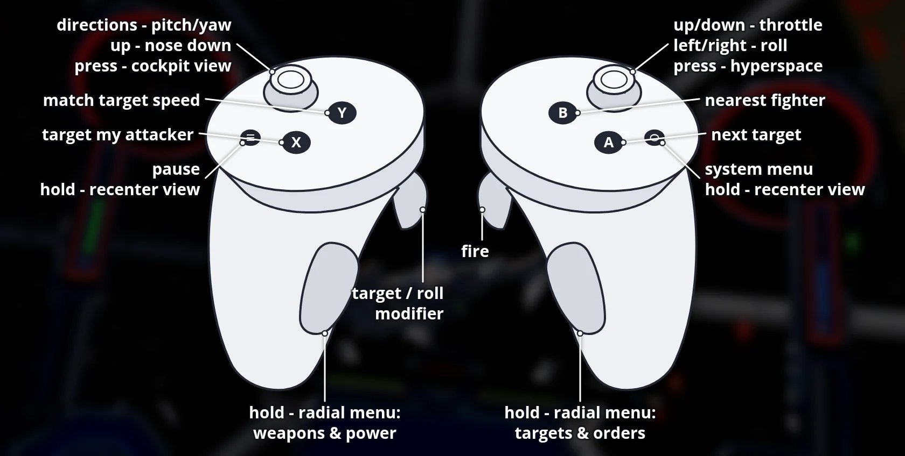

# OpenTIE VR for Meta Quest

**Download, install guide, controls and pictures: [portroyale.online/opentie.html](https://portroyale.online/opentie.html)**

Standalone Meta Quest 3 port of OpenTIE (Star Wars: TIE Fighter) with
OpenXR: menus on a virtual screen, head-tracked stereo 3D
space in flight, 3D cockpits with the original instruments, and
Touch controller support.

You need your own copy of TIE Fighter (Steam "STAR WARS TIE Fighter Special
Edition"). The APK contains no game data.

## Install

1. Install the APK with SideQuest or `adb install OpenTIE-VR-*.apk`.
2. Copy the game data to the Quest's internal storage (Steam folder
   `STAR WARS Tie Fighter`):
   - `collectors_cd` (1995 CD version) to `/sdcard/OpenTIE/TIE95`
   - `remastered` (1998 Windows version) to `/sdcard/OpenTIE/TIE98`

   For example:

       adb push ".../STAR WARS Tie Fighter/collectors_cd/." /sdcard/OpenTIE/TIE95/
       adb push ".../STAR WARS Tie Fighter/remastered/." /sdcard/OpenTIE/TIE98/

3. Optional, for the TIE Defender and Missile Boat 3D cockpits: if you own
   Star Wars: X-Wing Alliance, copy its game folder to `/sdcard/OpenXWA`
   (the same folder OpenXWA VR uses), or just copy
   `FLIGHTMODELS/TIECOCKPIT.OPT` to `/sdcard/OpenTIE/`. The TIE Fighter,
   Advanced, Interceptor, Bomber and Gunboat cockpits are included.
4. Start "OpenTIE VR" from Unknown Sources. On first start, allow
   "access to all files" when Android asks (or run
   `adb shell appops set --uid com.bilko.opentievr MANAGE_EXTERNAL_STORAGE allow`).

## Controls

Recenter: hold the Meta button on the right controller, or hold the left
Menu button for one second.

Menus (and in-flight screens such as the map and options):

| Input | Action |
|---|---|
| Laser (either controller) + trigger | Click |
| Right grip | Right-click |
| Left stick | Arrow keys, one step per push |
| A | Enter |
| B | Escape (Delete while the keyboard is open) |
| Y | Space |
| Laser + trigger on a text field | Open the on-screen keyboard (pilot name) |
| Left Menu, short press | Escape |

Flight (the Touch controllers act as one gamepad; every button can be
remapped in Settings > Controller):

| Input | Action |
|---|---|
| Left stick | Pitch and yaw (up = nose down, like a flight stick) |
| Right stick left/right | Roll |
| Right stick up/down | Throttle lever (stays where you leave it) |
| Right trigger | Fire |
| Left trigger | Target / roll-throttle modifier |
| A / B | Next target / nearest fighter |
| X / Y | Target my attacker / match target speed |
| Left stick click | Back to cockpit view |
| Right stick click | Hyperspace |
| Left Menu | Pause |
| Left grip (hold) | Radial menu: weapons and power |
| Right grip (hold) | Radial menu: targets and orders |

Radial menus: hold a grip and a star of eight commands appears above that
controller. Tilt the same hand's stick towards a command and release the
grip to run it; release with the stick centred to cancel. The stick doesn't
fly while it is choosing; everything else keeps working.

| Direction | Left (weapons and power) | Right (targets and orders) |
|---|---|---|
| Up | Laser recharge rate | Clear target |
| Up-right | Shield recharge rate | Next target component |
| Right | Cycle weapon (lasers / warheads) | Map |
| Down-right | Full throttle | Wingmen: attack my target |
| Down | Throttle down | Wingmen: cover me |
| Down-left | Beam weapon on/off | Mission goals |
| Left | Cycle firing mode | Flight menu (Escape) |
| Up-left | Cycle shield direction | Target's attacker |

## Known limitations (beta)

- Quest 3 tested only.
- 3D cockpits for the TIE Fighter, Advanced, Interceptor, Bomber and
  Gunboat come from X-Wing Revival (included); their small built-in screens
  are dark, the original instruments are mounted around you instead. The
  TIE Defender and Missile Boat use X-Wing Alliance's TIE cockpit from your
  own copy (see Install).
- Motion blur, temporal upscaling and ambient occlusion are off in stereo.
- Signed with a debug key.

## Build (Linux host)

Requirements: Android SDK + NDK 27.2.12479018, JDK 17, SDL_shadercross,
CMake, Ninja, Python 3.

    git submodule update --init --recursive
    tools/quest/build-deps.sh      # SDL3, zstd, FFmpeg, host shader tools
    tools/quest/build-native.sh    # libmain.so + runtime resources
    (cd android && ./gradlew assembleDebug)
    tools/quest/deploy.sh          # install, copy game data once, launch

VR code: `src/tie_vr/` (OpenXR session, input, layers; `tie_vr.c` is
generated from OpenXWA-VR's `xwa_vr.c` by `tools/quest/gen_tie_vr.py`;
radial menus in `vr_radial_menu.c` and `tools/quest/tie_vr_radial.inc.c`),
`src/tie_remaster/vr_stereo.*` and `flight/passes.c` (per-eye rendering),
`tools/quest/gen_vr_cockpit.py` (3D cockpit model),
`tools/quest/gen_revival_cockpits.py` (X-Wing Revival cockpits, converted
at build time from Revival's free game data; set `XW_REVIVAL_DATA` to its
`gamedata` folder), `src/tie_app/vr_keyboard.*`
(on-screen keyboard) and the Quest VR engine changes in the `aeron`
submodule ([Aeron commit 33bd7b7](https://github.com/elyosh/Aeron/tree/33bd7b732ae636f6c6a89bfb350372aad6f6a2ce)).

## Credits

3D cockpit models from [X-Wing Revival](https://www.raptor007.com/xwing/)
by Raptor007 and its contributors (originally from the X-Wing Alliance
Upgrade project).
